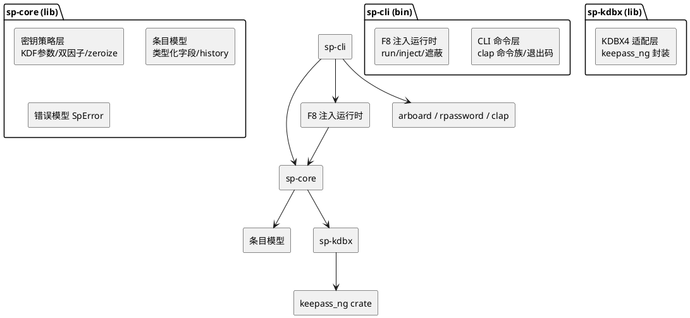
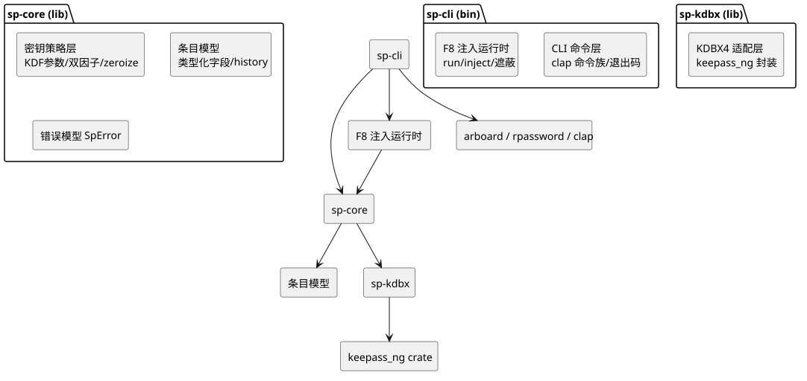

# 00 架构总览

- 状态：v1.0（2026-10-26）｜追溯：SRS §2/§8｜图：mermaid（流程/上下文）+ PlantUML（组件，SVG 已渲染）

## 1. 系统上下文

```mermaid
flowchart LR
    U[用户 / 脚本 / CI] -->|命令行| SP[sp.exe CLI]
    SP -->|读写 KDBX4| DB[("密码库 .kdbx\n(本地/用户自选云盘同步)")]
    SP -->|子进程+环境变量| CHILD[目标命令\n(sp run 的子进程)]
    SP -->|OS 剪贴板 API| CLIP[系统剪贴板]
    KXC[keepassxc-cli] -->|round-trip 对拍\n(仅测试)| DB
    CONFIG["config.toml\n(默认库/超时)"] --> SP
    SP -.->|零网络请求 SP-N-304| NET((无外部服务))
```

要点：库文件本身可在用户自选云盘同步目录中（云端只见密文，F3）；sp 自身零网络。

## 2. 组件图（PlantUML，渲染物 design_docs/diagrams/00_components.svg）





## 3. 依赖规则（架构红线）

| 规则 | 说明 |
|---|---|
| sp-cli 不直接依赖 keepass_ng | 所有库操作经 sp-core→sp-kdbx，保证可替换（DR-005 回退路径） |
| sp-core 零 IO 依赖泄漏 | 文件/剪贴板/终端在 sp-cli；sp-core 仅内存域（便于 SP-N-305 内存卫生测试） |
| 零网络 crate | 全工作区禁止引入任何网络依赖（CI deny.toml bans + 审查） |
| 平台差异集中 | ACL/剪贴板后端在 sp-cli 的 platform 模块，抽象 trait 供步骤 2/4 复用 |

## 4. 数据流总览

写入路径：CLI 参数 → 条目模型（sp-core 校验）→ KDBX 适配层（映射）→ keepass_ng 序列化 → 文件（先写临时文件 + 原子替换）。
读取路径：文件 → keepass_ng 解析（KDF 派生）→ 适配层映射 → 条目模型 → CLI 输出（stdout/剪贴板/子进程 env）。
