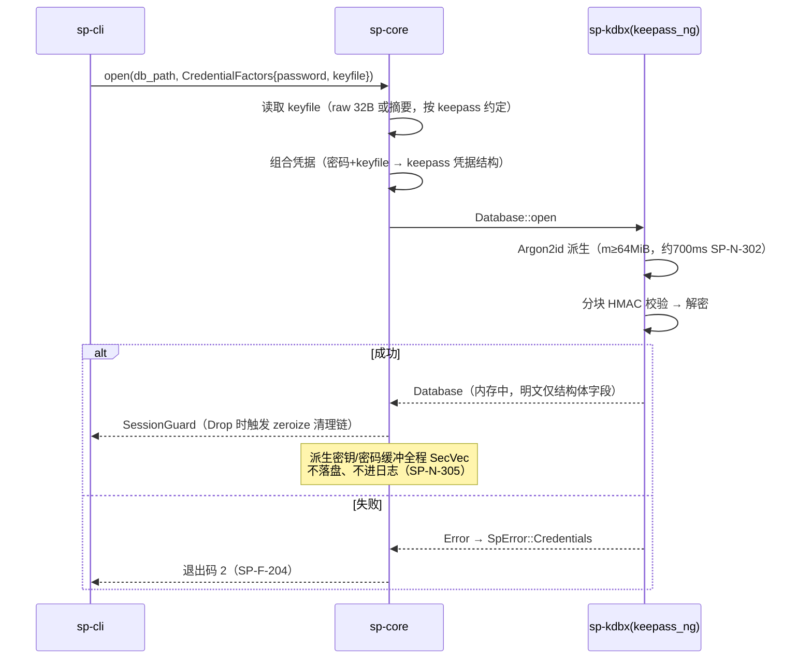
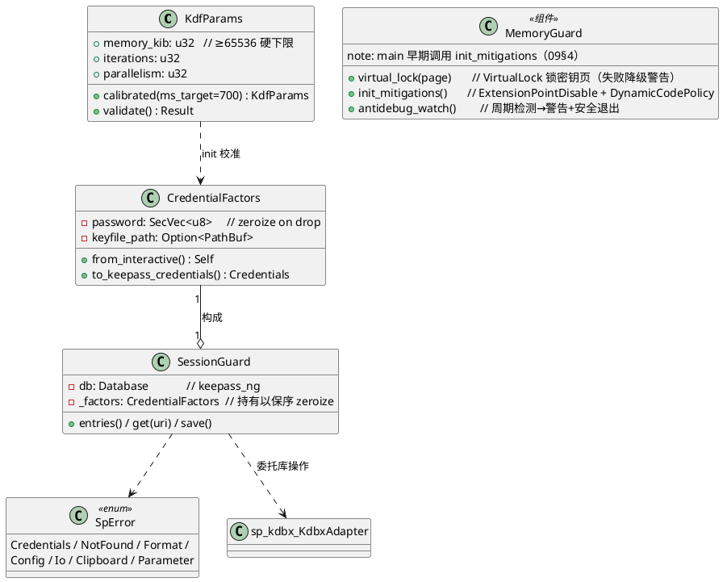
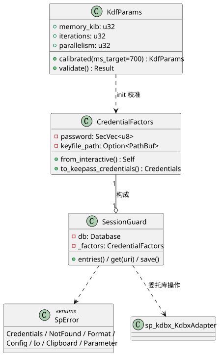

# 01 sp-core 密钥与策略层

- 状态：v1.0｜追溯：SP-F-101/105、SP-N-302/303/305、SP-C-101(#5#6#7)｜OOP：PlantUML（SVG 已渲染）

## 1. 职责边界（复审修正 1 的架构结论）

库内加密由 **KDBX4 格式**承担（keepass_ng：Argon2id KDF + AES-256/ChaCha20 分块 Encrypt-then-MAC）。sp-core **不做二次加密**，职责为：KDF 参数策略、双因子组合、内存卫生（zeroize 纪律）、条目模型、统一错误模型。

## 2. 解锁时序

## 3. 类设计（PlantUML，渲染物 diagrams/01_spcore_classes.svg）

## 4. 关键设计决策

| 决策 | 依据 |
|---|---|
| SessionGuard 单次进程持有，v0.1 无跨进程会话 | 冲刺复审修正 1（B13 风险后置） |
| SecVec（zeroize::Zeroizing<Vec<u8>>）强制类型 | SP-N-305；编译期防遗漏 |
| KDF 校准在 `sp init` 交互完成（试跑 3 次取中位） | SP-N-302 约 700ms |
| 错误链不携带密钥值 | 内存卫生 + 日志安全 |
| MemoryGuard：VirtualLock 页锁 + 进程缓解策略 + 反调试告警 | SP-N-310，详见《09_安全实现方案》§4（含限制声明） |
| keepass_ng XML DOM 残留如实声明（非全量零化） | 09§4 诚实边界 |

## 5. 测试挂钩

KdfParams::validate 边界（<64MiB 拒绝）；SessionGuard Drop 后缓冲区断言（debug_assertions 下检查零化）；SpError → 退出码映射全覆盖（SP-F-204）。
