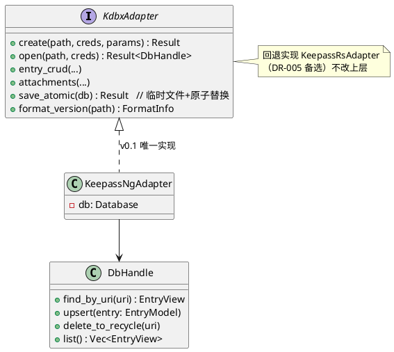
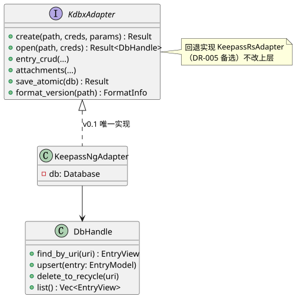
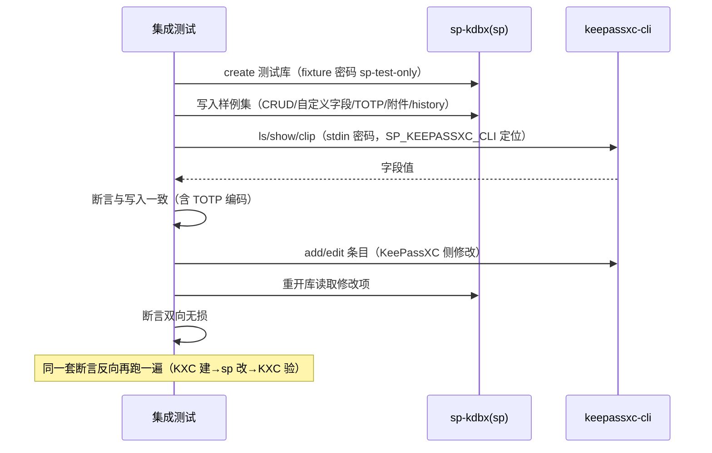

# 02 sp-kdbx KDBX4 适配层

- 状态：v1.1（2026-10-27，v1.1 变更=新增 §2.1 浏览器扩展摘要 API）｜追溯：SP-F-101/102/103/104/107、SP-F-702/706、SP-N-308｜OOP：PlantUML（SVG 已渲染）

## 1. 适配器设计（DR-005 回退策略的落点）

## 2. 条目模型 ↔ KDBX 映射表

| 模型字段 | KDBX 落点 | 备注 |
|---|---|---|
| title / username / password / url / notes | Entry 标准字符串字段 | password 置 protected 位 |
| 自定义字段（名/值/protected） | Entry custom strings (Binary/Value) | protected → ProtectedValue |
| TOTP（SP-F-601） | custom string `otp`，KeePass 约定编码 `seed?period=&digits=` | 与 KeePassXC 显示对拍 |
| history | Entry history 链（keepass_ng 内建） | edit 前自动推入 |
| 附件 | KDBX4 binaries（格式层加密）+ Entry binary 引用 | 1MB 基准 |
| 删除 | 移入 KDBX 回收站组 | SP-F-102 |
| 库级元数据 | Meta（生成器名 "SuperPasswdKey vX"） | SP-F-205 追溯 |

### 2.1 公开 API 增补（v0.2.0-ext，步骤 3）

`list_entry_summaries(db) -> Vec<EntrySummary>`（SP-F-702/706）：`EntrySummary { title, username, url, has_otp }`——**不含密码**的条目摘要，供 sp-nmhost 的 `sp.get-logins` 响应面使用；密码/TOTP 仍仅经 `find_entry` / `entry_totp_now` 单条显式取回（design_docs/10 §4 机密面约束）。与 `list_titles` 同层级（单组遍历实现），不改变既有 API 语义。

## 3. round-trip 对拍（集成测试，即持久测试资产——冲刺复审修正 3）

## 4. 错误映射表（→ SpError → 退出码）

| keepass_ng / I/O 错误 | SpError | 退出码 |
|---|---|---|
| 凭据错误（KDF/HMAC 失败） | Credentials | 2 |
| 魔数错/截断/未知格式版本 | Format | 1（SP-F-107，可行动提示） |
| 文件不存在/权限 | Io | 1 |
| keyfile 缺失/长度非法 | Credentials | 2 |

## 5. 平台抽象（SP-N-308 预埋）

文件权限与剪贴板后端按平台分支实现（v0.1 实测为 `cfg(windows)/cfg(unix)` 编译期分支，未引入运行期 trait——实测抽象成本大于收益，回退策略 trait 仍为 DR-005 预留方案）：
- 文件权限：Windows ACL（icacls）/ POSIX 0600（`PermissionsExt`）——`sp-cli::commands::restrict_perms`，v0.1.2-linux 起双平台实现并有单测覆盖。
- 剪贴板：arboard 跨平台后端（Windows 原生 / Linux X11、Wayland）；WSL 等无显示环境 clip 运行时报错属预期。
