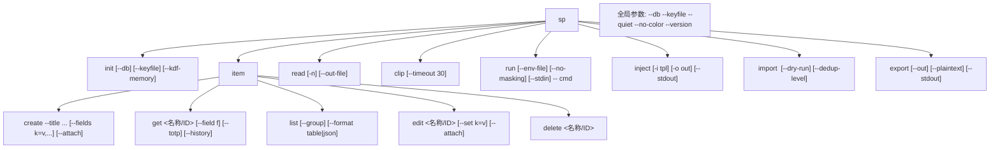
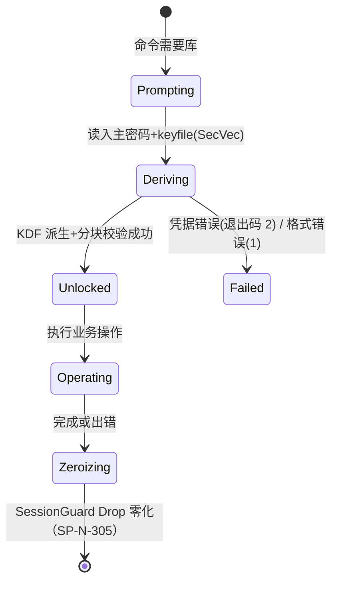

# 03 sp-cli 命令族与错误模型

- 状态：v1.0｜追溯：SP-F-201~206、SP-N-309｜图：mermaid

## 1. 命令树

## 2. 错误模型与退出码（SP-F-204）

| 退出码 | SpError 变体 | 触发示例 |
|---|---|---|
| 0 | — | 成功 |
| 1 | Format / Io / Config / Internal | 库损坏（SP-F-107）、配置损坏 |
| 2 | Credentials | 密码错/keyfile 缺失/未解锁 |
| 3 | NotFound | uri 无对应条目 |
| 4 | Parameter | 参数缺失/非法（clap 之外的业务校验） |

规则：错误一律 stderr；`--quiet` 抑制成功路径装饰输出（read/clip 本身即静默语义）；错误链不含密钥值（01 §4）。

## 3. 解锁状态机（单进程内）

v0.1 无跨进程缓存：每个命令独立走 Prompting→Zeroizing（冲刺复审修正 1）。

## 4. clip 生命周期

复制 → 立即返回（前台等待或提示后台）→ 计时（默认 30s，--timeout）→ 写空串清除。**限界明示**：Windows 剪贴板历史（Win+V）与云剪贴板不受应用控制（SP-F-203 验收注记）。

## 5. 平台行为

| 行为 | Windows | POSIX（v0.1.2-linux 已实现） |
|---|---|---|
| --out-file / inject 产物权限 | ACL 限定当前用户（icacls 语义） | 0600（`restrict_perms` 单测覆盖） |
| 交互输入编码 | UTF-8（Git Bash）/ UTF-16 转换（PowerShell 管道） | UTF-8 |
| 剪贴板 | arboard Windows 后端 | arboard X11/Wayland 后端（无显示环境报错属预期） |
| run 机密传递 | 环境块注入（无 /proc） | 默认环境块注入；`--stdin` 变体走 NUL 分隔 stdin（04 §4.1） |

## 6. 输出语言

英文（SP-N-309，assumption）；帮助文本含中文注释版 man 说明（README 中文，SP-F-303 威胁边界文案双语）。
