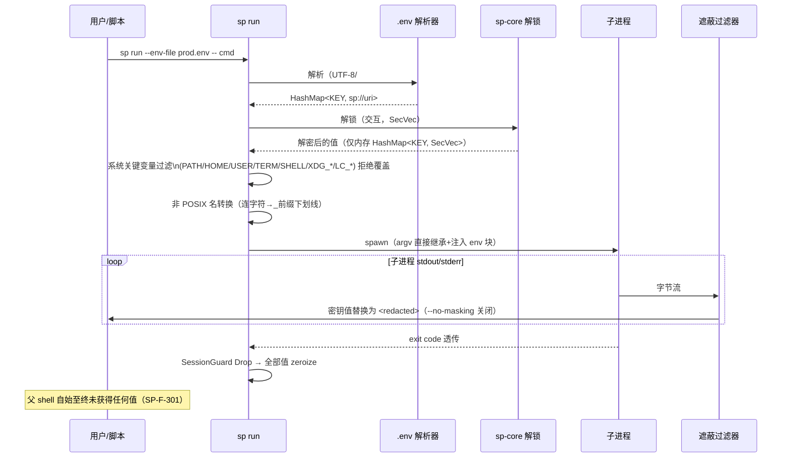

# 04 F8 注入运行时

- 状态：v1.0｜追溯：SP-F-301/302、SP-N-306、基线§3.2 十项验收｜图：mermaid

## 1. sp run 全时序

## 2. 遮蔽过滤器设计（SP-N-306 100% 替换的关键）

- 挑战：密钥值可能**跨 chunk 边界**被截断。
- 方案：流式过滤器保留"滚动尾缓冲"，长度 = max(所有密钥值字节数, 64)；每次匹配在 `tail + new_chunk` 拼接上做多模式查找（Aho-Corasick 或按值数量线性查找），只输出确认安全的尾巴；进程结束时 flush 尾缓冲（尾部长度 ≥ 最长密钥值-1，保证无跨边界泄漏）。
- 编码：按字节匹配（密钥值为原始字节）；UTF-8 边界由字节级匹配天然安全。

## 3. .env 解析规则（对齐 1Password op 官方全集，基线§3.2#6）

UTF-8；`#` 注释；单双引号剥离/保留规则；`$VAR`/`${VAR}` 展开（先文件内后环境）；`\$` 转义；多行值引号包裹；空值→空串；KEY 必须匹配 `[A-Za-z_][A-Za-z0-9_]*`，否则 POSIX 前缀化（`_` + 非法字符转 `_`，bws 语义）。

## 4. Windows 要点

- 环境块为 UTF-16：注入经 `std::process::Command` env 接口由标准库处理；测试覆盖 Git Bash/PowerShell/cmd 三壳。
- `--stdin` 变体（gopass 语义）规避 `/proc/environ` 类泄露：Windows 无 /proc，列为 POSIX 增强项（步骤 2）。
- 威胁边界（SP-F-303）：同 OS 用户进程可读子进程环境——README 双语文档强制项。

### 4.1 `--stdin` 变体（POSIX，v0.1.2-linux 实现）

对齐 gopass `env --stdin`（官方 man page："Pipe the secret's password to the subprocess's stdin instead of setting an environment variable"）：

- `sp run --stdin -- cmd`：机密**不写入**子进程环境（子进程仅继承父进程自身环境）；改为向子进程 stdin 写入 **NUL 分隔记录** `KEY=VALUE\0`（与 `/proc/environ`、`env -0` 同格式；多行值安全），写毕关闭 stdin 作为结束信号。
- 值解析（sp:// 引用）、POSIX 名转换、受保护变量拒绝（§1 过滤链）在 `--stdin` 模式下**同样生效**。
- stdout/stderr 遮蔽过滤器行为不变（§2）。
- stdin 写入在独立线程执行（子进程读入慢时不阻塞遮蔽转发与 wait）。
- 威胁边界：同 OS 用户进程仍可通过 ptrace/管道窃听读 stdin——本变体只消除 `/proc/PID/environ` 这一条泄露面（SP-F-303 文档同步）。

## 5. sp inject

`{{ sp://... }}` 占位渲染；`-o` 产物 ACL 限当前用户；`--stdout` 流式（不落盘）；产物含明文，输出后提示"用后即删"（基线§3.4）。

## 6. 测试挂钩

十项验收对照表逐项测试编号 T-301x；三 shell 矩阵；遮蔽跨边界构造用例（值长 64B+，输出分块 1B 步进）；系统关键变量保护断言。
