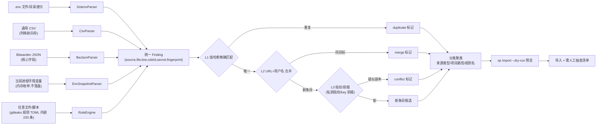
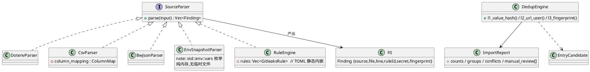
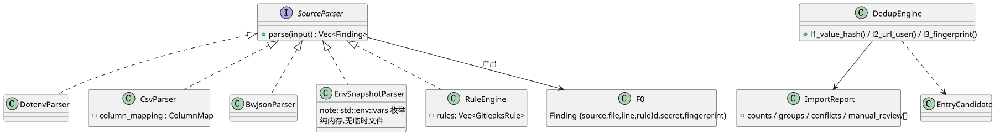

# 05 F9 导入器

- 状态：v1.0｜追溯：SP-F-401/402/403、基线§4｜OOP：PlantUML（SVG 已渲染）

## 1. 解析管道

原则：**冲突不清除**——全部保留打标记人工裁决（基线§4.3）。

## 2. 类设计（PlantUML，渲染物 diagrams/05_importer.svg）

## 3. 环境变量快照（SP-F-401④）

`std::env::vars()` 进程内枚举 → 逐值跑 RuleEngine → Finding（source="env"）；**无临时文件**（红线 #4、基线§4.5#6——gitleaks/trufflehog 均不支持 env 源，此为自研增量）。

## 4. 范围声明

Bitwarden JSON 仅核心字段（login/uri/notes/custom fields/TOTP），附件与 passkey 后置（SRS §2.3）；1pux 解析器 v0.2。分类器不做语义猜测（按来源路径聚类），机器分类 v0.2+。

## 5. 测试挂钩

每解析器 10+ 样例单测；proptest（合法输入不崩溃/往返一致）；三级去重构造样例断言（T-402）；dry-run 无副作用断言。
