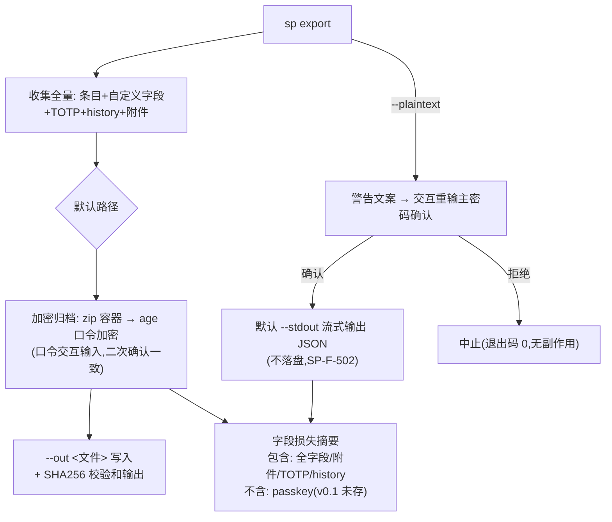
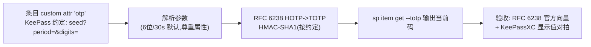

# 06 F10 导出与 TOTP

- 状态：v1.0｜追溯：SP-F-501/502/503、SP-F-601、基线§5｜图：mermaid

## 1. 导出双模式



红线落地：默认加密归档（行业空白点）；明文三重防护（flag+重输+警告）；stdout 流式一等（避免临时文件）；残留治理采用"不落盘"而非 shred（gopass ADR 结论：SSD 上不可靠）。

## 2. 加密归档结构

```
archive.age  ← age (scrypt passphrase 钳) 加密
  └─ archive.zip
       ├─ manifest.json      # 版本/时间/计数/字段摘要
       ├─ entries.json       # 全量条目（含 history）
       ├─ attachments/       # 二进制附件（原名+条目引用）
       └─ checksums.txt      # 内容 SHA256
```

## 3. TOTP（SP-F-601）



## 4. 测试挂钩

age 归档端到端解密断言；明文导出拒绝路径（无确认→退出码 0 无副作用）；stdout 流式端到端；字段摘要与实际内容一致性；TOTP 向量（SP-C-106 来源锁定）+ keepassxc 对拍。
