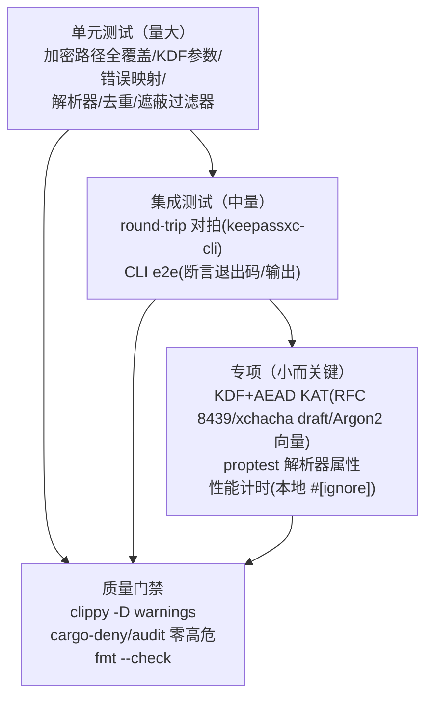
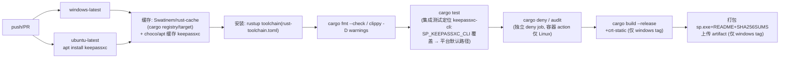

# 07 测试与 CI

- 状态：v1.0｜追溯：SP-N-301~307、SP-C-102/106｜图：mermaid

## 1. 测试金字塔



## 2. round-trip 对拍架构

```mermaid
flowchart LR
    subgraph 测试进程
      GEN[fixture 生成脚本\n(测试库/样例集,密码 sp-test-only)]
      SP[sp-kdbx / sp CLI]
    end
    GEN --> SP
    SP --> DB[(test.kdbx)]
    KXC["keepassxc-cli\n(SP_KEEPASSXC_CLI 定位\nstdin 密码)"] <--> DB
    KXC --> ASSERT[双向断言\nsp写→KXC验→KXC改→sp验]
```

## 3. CI workflow（GitHub Actions：windows-latest + linux(v0.1.2-linux 起) + deny）



要点：rust-toolchain.toml 锁 1.99.1；性能测试 `#[ignore]` 不阻塞 CI（SP-N-301）；`SP_SKIP_INTEROP=1` 后备仅在 keepassxc 安装失败时允许且日志必须可见（防假绿）；**cargo-fuzz 不进 CI**——fuzz/ 为独立 workspace，仅本地短跑（结果入 docs/reviews/）。

## 4. KAT/向量来源（SP-C-106）

XChaCha20-Poly1305：draft-irtf-cfrg-xchacha 官方向量；AEAD 基础：RFC 8439；Argon2id：参考实现向量；plus keepass_ng 自带测试。**禁止自造密文向量**；round-trip 数据由程序生成。

## 5. 覆盖率目标

加密/密钥路径（sp-core）100%；解析器与去重 ≥90% 行覆盖（tarpaulin/cargo-llvm-cov 本地度量，CI 记录不强阻塞）；遮蔽过滤器 100%（含跨边界用例）。

## 6. 安全实现方案测试（design_docs/09）

| 测试 | 验证点 |
|---|---|
| T-N310 | VirtualLock 调用成功/失败降级路径；缓解策略 API 调用断言；反调试触发→警告+退出 |
| T-N311 | 完整性基线：正常打开→基线更新（多设备场景无告警）；打开失败+哈希不符→提示外部修改 |
| T-N312 | 备份轮换：11 次保存→恰好 10 份；复制发生在原子替换之后（内容完整）；备份为密文 |
| KAT 来源 | RFC 8439 / xchacha draft / Argon2 官方向量（SP-C-106，禁止自造） |
