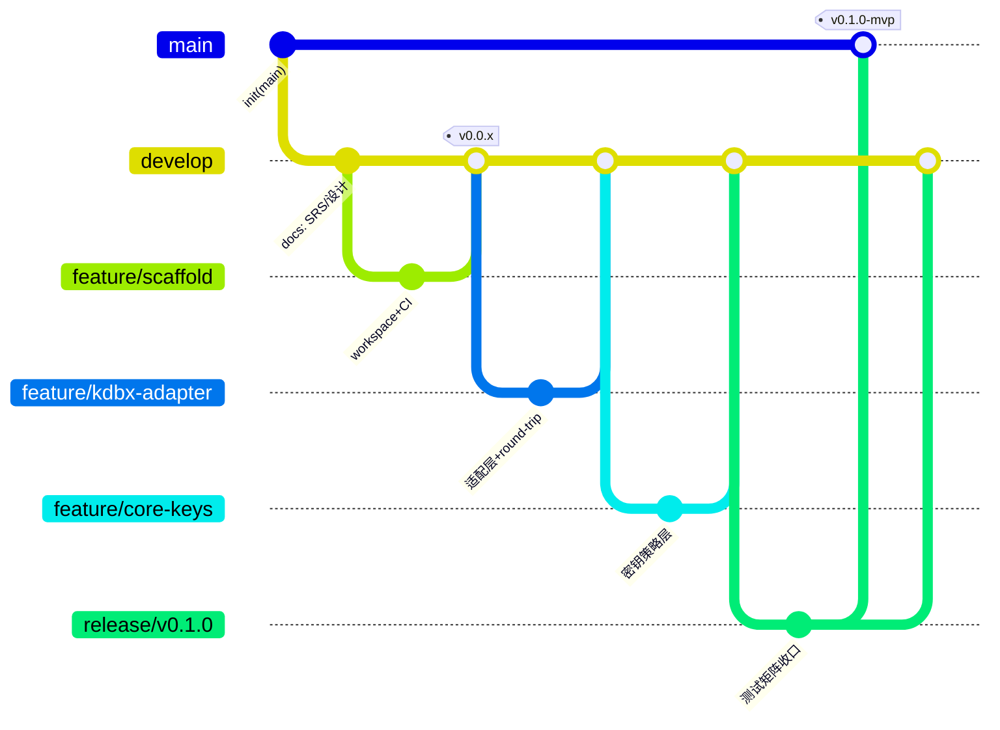

# 08 Git Flow 与发布

- 状态：v1.0｜追溯：SP-F-205、SP-C-101(#1#3)、SP-C-104｜图：mermaid gitGraph

## 1. 分支模型（标准 Git Flow，单人适配）

规则：`main` 仅接受 release 分支合入（--no-ff）；`feature/*` 从 develop 切出，PR 经 gh 创建、本地 `--no-ff` 合并（不停等，三个强制节点除外：SRS V1.0/设计复审/release 定版）；`release/v0.1.0` 只做测试修复；hotfix 走 main→hotfix/*→双合并。提交规范 Conventional Commits（feat/fix/docs/test/chore），文档与代码改动同 commit（实现中发现设计错误：先改 design_docs 再改码，提交信息注明 `docs(design): <原因>`）。

## 2. 版本注入（SP-F-205）

build.rs 读取 `git describe --tags --dirty`（缓存于 OUT_DIR，非 git 环境回退 CARGO_PKG_VERSION）→ `sp --version` 输出 `sp 0.1.0-mvp (g<hash>, dirty?)`。发布红线 #1 的追溯基础。

## 3. 发布产物（打包清单）

| 文件 | 说明 |
|---|---|
| sp-x86_64-pc-windows-msvc.zip | sp.exe（`+crt-static` 静态 CRT，免 VC 运行库）、README.md、SHA256SUMS.txt |
| SHA256SUMS.txt | 全部产物校验和（CI 生成，公钥签名 Minisign 于 v0.2 接入——红线 #1 分阶段） |

缓存策略（用户注意事项落地）：Swatinem/rust-cache（cargo registry+target）；choco keepassxc 走 Chocolatey 默认缓存；rustup 工具链用 rust-toolchain.toml 锁定版本避免重复下载。

## 4. 环境预装要求（CI 与本地一致）

Rust（rustup，工具链锁定）｜keepassxc（choco/winget，仅测试）｜无其他外部依赖（crt-static 免运行库）。

## 5. 后续步骤衔接

步骤 2（WSL）：同仓 clone 至 WSL，`cargo test` Linux GNU 目标 + 文件权限 0600 分支测试；CI 增加 ubuntu job。步骤 3（浏览器扩展）：native messaging host 复用 sp-core（设计另立 design_docs/1x）。步骤 4（Android）：UniFFI 绑定 sp-core。
