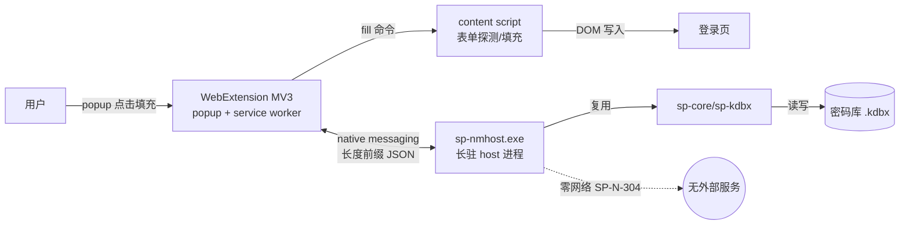

# 10 浏览器扩展总体（F1：native messaging + 本填充引擎）

- 状态：v1.0（2026-10-27）｜追溯：SP-F-701~707｜决策：DR-006｜图：mermaid
- 前置：SRS V1.1（F1 由非目标升级为正式需求，编号段 SP-F-7xx）；参照 keepassxc-protocol.md（https://github.com/keepassxreboot/keepassxc-browser/blob/develop/keepassxc-protocol.md ，2026-10-27 实测可达）

## 1. 系统上下文

要点：浏览器经 native messaging 拉起 `sp-nmhost`（端口打开期间常驻）；加密解密全部在 host 进程本地完成；扩展端只做表单探测与填充，不持有任何落盘机密（chrome.storage 全程禁用，红线映射 SP-F-707）。

## 2. 组件与仓库布局

| 组件 | 位置 | 说明 |
|---|---|---|
| native messaging host | `crates/sp-nmhost`（Rust workspace 成员，bin `sp-nmhost` + lib 供 fuzz） | stdin/stdout 长度前缀 JSON-RPC；复用 sp-core/sp-kdbx 解锁与条目读取；URL 匹配引擎（Rust 侧单源）；注册/注销 PowerShell 脚本在 `native-host/` |
| WebExtension | `extension/`（TypeScript，MV3，无运行时 npm 依赖） | content script 表单探测与填充；popup 列表/搜索/解锁；service worker 与 host 通信 + 保活；vitest 单测表单探测规则 |

依赖规则沿用 00 §3 并新增一条：**sp-nmhost 不直接依赖 keepass_ng**（经 sp-kdbx），全工作区零网络 crate（deny.toml bans 继续覆盖）；`extension/` 运行时零 npm 依赖（供应链卫生，红线 #10）。

## 3. host 进程形态与会话策略（DR-006 结论）

- **形态**：`sp-nmhost` 独立长驻二进制（非 `sp` 子命令）：manifest 指向固定路径，`sp` CLI 命令树不受污染；lib target 暴露协议编解码供单测与 fuzz。
- **会话策略（方案 A）**：解锁一次后缓存 `CredentialFactors`（sp-core `SecureString`，zeroize）于 host 内存；每次请求重新读库解密。
- **技术事实（keepass_ng 0.11.12 源码核实）**：`DatabaseKey` 为 `Clone + ZeroizeOnDrop`，但 `get_key_elements` 为 `pub(crate)`，**无公开的"复合密钥直开库"API**——每请求必然重走 Argon2id KDF（约 700ms，SP-N-302）。单请求总延迟 ≈ KDF + 解析（除 KDF 外满足 SP-N-303 <50ms）；填充场景可接受。密钥复用开库（省 KDF）列入 backlog，需 keepass_ng 提供 composite-key API 或适配层自实现（DR-005 trait 预留）。
- **超时**：host 空闲超时（默认 300s，`--session-timeout`）自动锁库（丢弃凭据因子，zeroize）；锁后仍可再次 `sp.unlock`；进程随端口关闭退出（native messaging 平台语义）。
- **解锁入口**：扩展 popup 输入主密码 → `sp.unlock` 经 native messaging 管道传输一次 → host 派生校验后立即不持明文（凭据因子内 SecString 持有；协议缓冲用后即清——JSON 反序列化残留风险与 09 §4 DOM 残留同级，如实声明）。keyfile 不经管道：host 从 `--keyfile` 参数或 config.toml 解析。

## 4. 安全边界（对齐 09 / SP-F-303）

| 边界 | 措施 | 限制（如实声明） |
|---|---|---|
| 调用方 | manifest `allowed_origins` 绑定扩展 ID（无通配，官方文档明确）；host 校验启动参数首参 origin | unpacked 开发扩展 ID 由加载路径 SHA-256 派生，换路径即变 ID，需重注册；发布需固定签名密钥 |
| 机密面 | host 不提供"导出全库/全字段枚举值"能力；`sp.get-logins` 只回 id/title/username；密码/TOTP 仅 `sp.get-secret` 显式单条取回 | get-logins 的 username 明文过管道（KeePassXC 同级语义） |
| 扩展端 | 机密只进内存：popup/SW/content 收到即用即弃，不进 chrome.storage、不进 localStorage、不落临时文件（SP-F-707，红线 #4/#5 延伸） | 同 OS 用户恶意扩展无法读取（MV3 隔离），但同浏览器内其他扩展经 DOM 读到已填充值属页面固有风险（与 KeePassXC-Browser 一致） |
| 管道 | 本机管道仅浏览器与 host 持有句柄；协议加密见 11 §6（P1/P2 适配器） | P1 明文管道的残余风险在 11 §6.3 声明 |
| 进程 | host 继承 sp-cli 同级进程加固评估（09 §4）：SecVec/zeroize 必做；VirtualLock/缓解策略按 09 P0 范围在 host 侧复用同一平台模块思路 | 与 CLI 相同的诚实边界 |

## 5. 填充验收基线（B4 最小集）

- 登录表单单页填充可用：本地 demo 页（`extension/dev/login-demo.html`，localhost http）真实登录字段填充成功（Chrome 实测，清单见 docs/reviews/）。
- 不进本期（backlog）：iframe/SPA 动态表单、多步登录、"自动保存"新凭据捕获、Firefox 适配（协议已按跨浏览器留位）。

## 6. MV3 service worker 生命周期约束（必须在协议层消化）

官方文档核实（2026-10-27，developer.chrome.com）：

1. SW 空闲 30s 被终止；事件/API 调用重置计时。
2. Chrome 105+：`connectNative()` 计入活动；Chrome 114 起**仅端口的收发消息**重置计时（仅打开端口不够）。
3. SW 被终止 → 端口断开 → **host 进程被杀死**（密钥缓存随进程消失）。

对策（写入协议 11 §7）：解锁期间扩展用 `chrome.alarms`（≥Chrome 120 最小 30s）周期 `sp.ping`（收发双向重置 SW 计时 + 刷新 host 空闲计时）；断线重连逻辑：端口意外断开 → SW 标记会话失效 → 下次操作引导重新解锁（host 已死，无残余）。绝对会话上限由 host 空闲超时兜底。

## 7. 与既有文档的关系

- 00 架构总览：新增 sp-nmhost 组件（00 §5 已预告"设计另立 design_docs/1x"→ 即本文系列）。
- 03 解锁状态机：host 侧复用其单进程状态机语义（Locked→Deriving→Unlocked），新增"空闲超时锁库"迁移与"进程退出=Zeroizing"。
- 09 安全实现方案：§4 进程保护/§5 文件保护条款对 host 同样适用；本系列不复制其内容，只引用。
- 08 §5：步骤 3 衔接更新为实现态。
