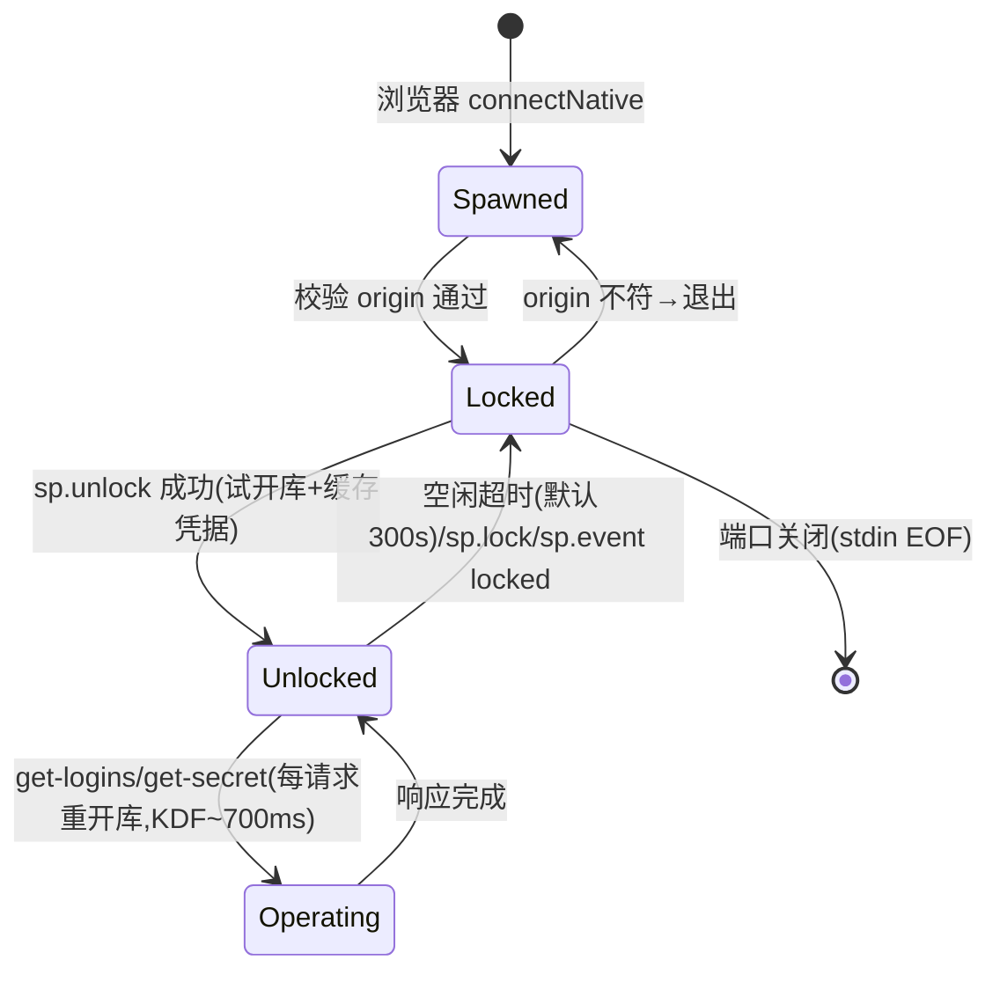

# 11 native messaging 协议（sp-nmhost ↔ WebExtension）

- 状态：v1.0（2026-10-27）｜追溯：SP-F-702、SP-F-703、SP-F-706｜决策：DR-006
- 依据（官方文档，2026-10-27 实测核实）：developer.chrome.com native messaging / service worker lifecycle；keepassxc-protocol.md（https://github.com/keepassxreboot/keepassxc-browser/blob/develop/keepassxc-protocol.md ）

## 1. 帧格式（native messaging 平台层）

- stdin/stdout 双向：每帧 = **32 位消息长度（本机字节序）+ UTF-8 JSON**。两端支持平台（Windows x64 / Linux x64）均为小端。
- 大小上限（Chrome 官方）：host→浏览器单帧 ≤ **1 MB**；浏览器→host 单帧 ≤ **64 MiB**。host 侧另设自防上限 **8 MiB**（超长帧直接断开，防 DoS——合法负载远小于此：单条凭据 <1KB，get-logins 1000 条 <100KB）。
- host 进程由浏览器拉起，**首参数为调用方 origin**（`chrome-extension://<id>/`）：host 校验其与构建期/配置期绑定的扩展 ID 一致，不一致立即退出（第二道防线，与 manifest allowed_origins 并列，SP-F-701）。

## 2. 消息信封与编解码适配器（DR-006 之二：P1/P2 切换点）

信封结构（每帧 JSON 的最外层）：

```json
{ "v": 1, "codec": "plain", "payload": { ... } }
```

- `v`：协议主版本；不兼容变更时递增，host 拒绝未知 `v`。
- `codec`：payload 编解码器标识，即 **P1/P2 适配器切换点**。两侧各实现 `Codec` trait / `SpCodec` 接口：

| codec | payload 语义 | 状态 |
|---|---|---|
| `plain` | payload 即业务 JSON 对象（明文） | **MVP 实现（P1）** |
| `naclbox` | payload 为 `{nonce, box}`（base64）；TweetNaCl box 加密，握手复用 KeePassXC `change-public-keys` 流程（双方临时 X25519 密钥对） | **预留（P2，backlog）**：接口位、错误码、版本协商已就位，未实现加密体 |

适配器纪律：业务层（动作处理/状态机）**不得感知 codec**；新增 P2 时只动编解码层与一个握手动作，不改动作集。

## 3. 动作集（payload 结构，参照 keepassxc-protocol 的 action/requestID 风格）

请求：`{action, requestID}`；响应：`{action, requestID, success, data?|error?}`。`requestID` 由扩展生成（8 位随机），host 原样回传用于匹配。

| action | 方向 | 请求字段 | 响应 data | 说明 |
|---|---|---|---|---|
| `sp.ping` | 双向 | — | `{locked: bool, user: "sp-nmhost v<ver>"}` | 保活 + 状态探测 |
| `sp.status` | 扩→host | — | `{locked, dbPath?, sessionTimeoutSecs}` | popup 初始化 |
| `sp.unlock` | 扩→host | `{password: string}` | `{entryCount}` | 主密码**仅此一次过管道**；host 校验（试开库）后缓存凭据因子；失败错误码 `credentials` |
| `sp.lock` | 扩→host | — | `{}` | 显式锁库（丢弃凭据因子） |
| `sp.get-logins` | 扩→host | `{url, submitUrl?}` | `{matches: [{id, title, username, url}]}` | URL 匹配引擎在 host（12 §3）；**不含密码** |
| `sp.get-secret` | 扩→host | `{id, field: "password"|"totp"}` | `{value: string}` | 单条显式取回；`id` = 条目标题（v0.1 条目模型以 title 为键，局限如实声明） |
| `sp.save-login` | 扩→host | `{url, username, password}` | `{saved: "added"\|"updated", title}` | **登录自动保存**（SP-F-708，step8 新增；v1 内向前兼容——旧 host 回 `badrequest`，扩展须容忍）。归属 host = 解析 URL 后的小写 `host[:port]`（**仅 http/https 白名单；host 不发起任何网络请求**）；去重=条目 url 的 host(含端口)+username **精确相等**（对齐 SP-F-805，不归并子域）→ 命中 `edit_entry`（旧密码自动进 history），未命中 `add_entry`（标题=host，撞题 `host (username)` 多级消歧）。锁定态回 `locked`；空 username/password 回 `badrequest`；**密码仅此一程过管道、不进错误链、不落 host 日志**。桌面端更新路径 notes/otp 保真，自定义字段清空（FFI 读回面限制，与 Android M2 同口径，design_docs/15 §9） |
| `sp.event` | host→扩（主动） | — | `{event: "locked"}` | 空闲超时锁库通知；扩展随即停止保活 |

错误模型：`error: {code, message}`，code ∈ `badrequest` | `locked` | `credentials` | `notfound` | `internal`。host 对未知 action 回 `badrequest`。红线映射：无任何"导出全库/全字段枚举"动作（10 §4）。

## 4. P1 vs P2 全方位比较（DR-006 决策依据）

| 维度 | P1 明文管道（MVP） | P2 TweetNaCl box（KeePassXC 式） |
|---|---|---|
| 机密暴露面 | 主密码/密码字段明文过本机管道；管道句柄仅浏览器与 host 持有，OS 层非文件系统可见 | 管道只见密文；即使句柄被同用户进程观测也无明文 |
| 主要威胁 | 同 OS 用户进程注入浏览器/host 内存可读明文——**该威胁 P2 同样不可防**（内存注入即拿到明文源头） | 对"管道窃听"类攻击纵深防御；对内存注入无增益 |
| allowed_origins 绑定 | 已限定调用方为固定扩展 ID（伪造需扩展私钥） | 同左，加密不改变调用方信任模型 |
| 工期 | 0（直通） | +握手状态机、nonce 管理、两侧 tweetnacl 依赖（Rust `tweetnacl` + npm `tweetnacl`）、跨语言测试向量对拍，约 +2~3 天 |
| 失败模式 | 无新增 | nonce 重放/递增错误、密钥对生命周期管理引入的新 bug 面 |
| 互操作 | 与 keepassxc-protocol 不兼容（自有动作集） | 同上（box 层参照但动作集自有；完整互操作需另行设计） |
| 审计 | 管道抓包即明文，验证直观 | 需 KAT 向量验证实现正确性（SP-C-106 纪律可满足，成本在持续维护） |

**结论（DR-006）**：MVP 采用 P1 + 边界声明；`codec` 字段与适配器接口即切换点，P2 按需补实现，业务层零改动。

## 5. P1 残余风险声明（SP-F-303 范围）

明文管道的可读对象限定为：浏览器进程、host 进程、持有句柄的同用户进程（Windows 匿名管道句柄继承面极小）。与 KeePassXC-Browser 的差别在于其多加了 box 层——本项目将该层列为按需升级而非 MVP 门槛，理由：对目标威胁模型（同用户恶意软件）加密层不改变可防性，工期收益优先。此声明随 SP-F-303 双语威胁边界文档同步。

## 6. 注册与发现（Windows）

- manifest 文件（JSON）：`name=com.superpasswdkey.host`、`type=stdio`、`path=sp-nmhost.exe 绝对路径`、`allowed_origins=["chrome-extension://<扩展ID>/"]`（无通配）。**Chrome manifest 不支持启动参数**，host 侧配置统一由 `register.ps1` 写 `%LOCALAPPDATA%\SuperPasswdKey\nm-host-config.json`：`allowed_origin`（第二道防线）、`db_path`/`keyfile_path`（库与 keyfile，优先级：CLI 参数 > 本文件 > config.toml）、`session_timeout_secs`。host 启动时读取（`--allowed-origin` 参数与 `SP_NM_ALLOWED_ORIGIN` 环境变量可覆盖 origin；均未配置则 stderr 告警后放行，仅剩 manifest 一道防线——开发模式）。
- 注册（HKCU，免管理员）：`HKCU\Software\Google\Chrome\NativeMessagingHosts\com.superpasswdkey.host`（默认值 = manifest 路径）；Edge：`HKCU\Software\Microsoft\Edge\NativeMessagingHosts\...` 同构。
- `native-host/register.ps1`：参数 `-HostExe`（sp-nmhost.exe 路径）、`-ExtensionId`；生成 manifest 到 `%LOCALAPPDATA%\SuperPasswdKey\nm-host-manifest.json` 并写注册表（Chrome+Edge）；`unregister.ps1` 注销删除。unpacked 扩展 ID = SHA-256(加载目录绝对路径) 前 32 hex 经 a–p 映射（Chrome 规则），脚本不代算，由加载后 `chrome://extensions` 读取（操作手册见 docs/reviews/ 手工清单）。

## 7. 会话状态机与 MV3 保活（SP-F-703）



扩展侧保活（MV3，官方文档 2026-10-27 核实）：解锁成功后启动 `chrome.alarms` 周期（0.5min，需 Chrome ≥120；下限 1min 回退）→ onAlarm 发 `sp.ping`——收发双向重置 SW 30s 空闲计时（Chrome 114+ 语义）并刷新 host 空闲计时；`sp.lock`/锁库事件/浏览器退出即停止。断线重连：端口 onDisconnect → 会话失效标记 → 下次操作引导重新解锁（host 已被杀死，无残余状态）。绝对上限由 host 空闲超时兜底（不依赖扩展诚实）。

## 8. 测试要点（T-702/T-703 挂钩）

- 帧编解码：长度前缀 round-trip、边界（0 长度、1MB 上限、超限断开、非法 UTF-8、截断帧）。
- 非法输入不 panic：任意字节流 → 解码器返回错误不崩溃（fuzz 目标 `nm_protocol`，独立 workspace fuzz/）。
- 动作处理：locked 状态下 get-secret→`locked`；未知 action→`badrequest`；requestID 原样回传。
- 状态机：解锁失败 N 次不崩溃；空闲超时锁库（时钟可注入）。
