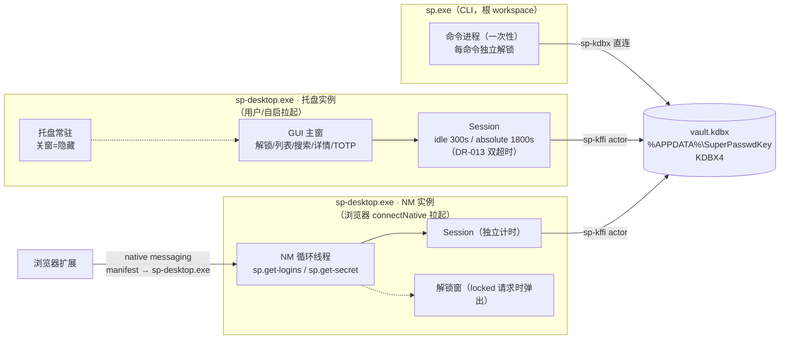
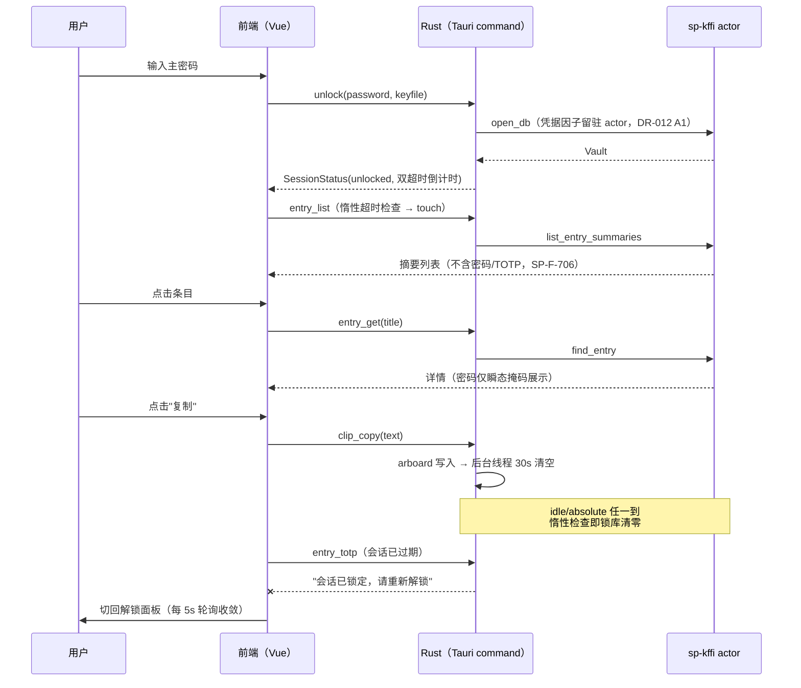

# 16 桌面 GUI：Vue 3 + Vite 全功能界面（DR-014）

- 状态：v1.6（2026-10-31，验收反馈轮：编辑中暂停空闲锁定（absolute 保留，§5.2 修订）+ keyfile 路径记忆与文件浏览（settings.json keyfile_path，SP-F-904 扩展）+ 保存后列表/详情即时刷新；v1.5 §8.4 清单独立化；v1.4 S1b-2b；v1.3 标签全栈；v1.2 S1b-1 写路径；v1.1 §8 手工验收；v1.0 S1a 设计与 MVP 落地）
- 上游依赖：design_docs/15（桌面形态，托盘/会话/NM 嵌入基座）、DR-013（凭据驻留策略）、DR-012（actor 内凭据因子）、SP-F-9xx（SRS §3.9 桌面需求）
- 范围：S1a = 设计与只读 MVP（解锁/列表/搜索/详情/TOTP/复制）；写路径（条目 CRUD/附件/TOTP 编辑）在 S1b，导入导出/注入启动器在 S1c

## 1. DR-014 决策记录：前端选型 Vue 3 + Vite（修订 design_docs/15"零 Node"闸门）

### 1.1 背景

design_docs/15 §3 将 `desktop/ui/` 定为"静态零 Node 依赖"前端（v0.3.0 已交付：解锁窗 + 设置面板，约 400 行 vanilla JS）。S1a 起桌面壳从"托盘 + 解锁"扩展为全功能 GUI（对标 1Password 桌面端形态）：大条目列表、即时搜索、详情侧栏、TOTP 动态码轮询、复制按钮、后续写路径表单。手写 vanilla JS 维护这类状态密集界面的成本显著上升（列表过滤/选中态/轮询计时器/表单校验各自手写），且 S1b/S1c 还要叠加条目编辑器、导入导出向导、注入启动器。

### 1.2 选项与权衡

| 方案 | 核心优劣 | 代价 | 影响面 |
|---|---|---|---|
| **A. Vue 3 + Vite（选定）** | 组件化 + 响应式状态天然匹配列表/搜索/详情/轮询；SFC 单文件组件按视图拆分；生态成熟；官方 Tauri 模板一等支持 | 桌面 workspace 引入 pnpm 构建链（构建期依赖，运行期零 Node）；CI desktop/windows job 补 pnpm install | desktop/ui/ 全量重写；tauri.conf.json 接入 devUrl/beforeDev/beforeBuild；CI 两 job |
| B. Vanilla JS 渐进增强 | 零构建链，v0.3.0 已验证 | 状态管理/列表过滤/计时器轮询全部手写，S1b 表单校验成本高；长期维护劣化 | 仅 ui/ 内迭代 |
| C. Svelte + Vite | 编译期框架，运行时更小，语法简洁 | 团队熟悉度低；生态/模板成熟度逊于 Vue；后续招人与文档口径成本 | 同 A 的构建链代价 |

### 1.3 结论与理由

**结论**：选 A，Vue 3 + Vite + TypeScript，替换 `desktop/ui/` 静态页。**安全面不变**：机密不进前端存储（SP-F-707 口径延续）——密码值只经 Tauri invoke 参数瞬态传给 Rust，前端不写 localStorage/sessionStorage/IndexedDB，不落日志；Vue 响应式状态仅存非机密展示数据。

**理由**：全功能 GUI 的组件化/状态/表单效率是选型主因；构建链影响可控（CI 已有 pnpm/action-setup 基础，desktop 独立 workspace 的 tauri 构建本就要 Node 生态配合）；Vue 是 Tauri 官方模板一等公民，长期维护与招人成本最低。

### 1.4 构建链影响评估

- `desktop/ui/` 转为 Vite 项目（package.json / vite.config.ts / tsconfig / index.html / src/）。
- `tauri.conf.json`：`build.frontendDist` → `../ui/dist`；新增 `devUrl`（http://localhost:1420）+ `beforeDevCommand`（pnpm dev）+ `beforeBuildCommand`（pnpm build）。窗口尺寸随 GUI 形态放大（见 §3）。
- CI：desktop job 与 windows（tag）job 在 `cargo tauri build` 前补 `pnpm install --frozen-lockfile`（工作目录 desktop/ui）；新增 `pnpm test`（vitest 组件测试）步骤。
- 供应链：前端依赖经 pnpm lockfile 钉版；tauri/deny 扫描面不变（前端依赖不进 cargo-deny 图）。
- 运行期零 Node：Vite 仅构建期；产物为静态 JS/CSS 由 tauri 打包进 NSIS，与 v0.3.0 静态页同性质（CSP `default-src 'self'` 约束不变）。

## 2. 信息架构

单窗口应用（托盘常驻，关窗=隐藏，沿用 design_docs/15 §2）。窗口内按会话状态切换视图，无路由库（MVP 用组件级视图切换，S1b 后视需要引入）：

```
┌─ 主窗（1024×720，可缩放）─────────────────────────────────┐
│ 顶栏：SuperPasswdKey · 会话状态（已解锁/剩余）· 锁定 · 设置 │
├──────────────────────────┬─────────────────────────────────┤
│ 左栏：搜索框 + 条目列表   │ 右栏：详情（只读，MVP）          │
│ （标题/用户名/URL/TOTP标）│ 标题/用户名/密码(掩码+复制)/     │
│ 点击选中 → 右栏联动       │ URL/备注/TOTP 动态码+复制        │
└──────────────────────────┴─────────────────────────────────┘
解锁态：上述主界面          锁定态：解锁面板（密码/keyfile）
设置：顶栏入口 → 设置面板（复用 v0.3.0：空闲/绝对分钟 + 自启）
```

视图清单（S1a MVP → S1b/S1c 增量）：

| 视图 | S1a | S1b-1 | S1b-2 | S1c |
|---|---|---|---|---|
| 解锁面板（密码 + keyfile） | ✅ | | | |
| 主界面（列表 + 搜索 + 详情只读） | ✅ | | | |
| TOTP 动态码 + 复制 | ✅ | | | |
| 详情交互增强：显示/放大显示（1Password 对标） | | ✅ | | |
| 条目创建/编辑/删除（表单校验对齐 CLI） | | ✅ | | |
| 自定义字段编辑 UI（S1b-2b：表单行增删 + 保留名校验；v0.1 protected 不持久化） | | | ✅ | |
| 标签（KDBX4 原生 Tags，全栈 CLI+GUI） | | | ✅ | |
| 附件管理（列表/添加/下载限权） | | | ✅ | |
| 附件管理（add/list/get） | | | ✅ | |
| 导入/导出向导 | | | | ✅ |
| 注入启动器 | | | | ✅ |

## 3. 组件树

```
App.vue（根：会话状态轮询 5s → 视图切换 + 顶栏）
├── UnlockPanel.vue          解锁面板（密码/keyfile/解锁按钮/错误提示）
├── MainView.vue             解锁态主界面（＋ 新的项目入口）
│   ├── SearchBox.vue        搜索框（即时过滤）
│   ├── EntryList.vue        条目列表（标题/用户名/URL/TOTP 标记）
│   ├── EntryFormModal.vue   创建/编辑表单（S1b-1；校验对齐 CLI，custom_fields 保真回传）
│   └── DetailPanel.vue      详情（S1b-1：编辑/删除入口 + 自定义字段只读展示）
│       ├── 密码行 ▾ 下拉     显示（掩码↔明文）/ 放大显示 / 复制
│       ├── LargeTypeModal.vue 放大显示（全屏大字号，点击/Esc 关闭）
│       └── TotpField         TOTP 动态码（30s 轮询 + 复制）
├── SettingsPanel.vue        设置（空闲/绝对分钟 + 自启，复用 v0.3.0 语义）
└── TopBar.vue               顶栏（状态/锁定/设置入口）
```

状态管理：MVP 用组件内 `ref`/`computed` + 一个轻量 `useSession` composable（会话状态、touch、锁定），不引入 Pinia（S1b 写路径复杂化后再评估）。

## 4. Tauri command 面映射

GUI 操作 ↔ Tauri command ↔ sp-kffi/Vault 调用（机密纪律：password 仅存在于 command 调用栈，即用即弃）：

| GUI 操作 | Tauri command | Rust 侧实现 | sp-kffi/Vault 调用 |
|---|---|---|---|
| 查询会话状态 | `session_status` | `Session::status()`（惰性超时检查） | — |
| 解锁 | `unlock(password, keyfile)` | `Session::unlock()` → `sp_kffi::open_db` | 凭据因子留驻 actor（DR-012 A1） |
| 立即锁定 | `lock_now` | `Session::lock_now()` | `Vault::lock()`（actor drop 清零） |
| 刷新空闲计时 | `touch` | `Session::touch()` | — |
| 读设置 | `get_settings` | `settings::load_or_default()` | — |
| 保存设置 | `save_settings(s)` | settings.json + 自启对账 | — |
| **列条目** | `entry_list`（新增） | `Session::entry_list()`（惰性锁库检查） | `Vault::list_entry_summaries()` |
| **取详情** | `entry_get(title)`（新增） | `Session::entry_get()` | `Vault::find_entry_full()`（Rust-only 面，含 custom_fields） |
| **TOTP 动态码** | `entry_totp(title)`（新增） | `Session::entry_totp()` | `Vault::entry_totp_now()` |
| **新建条目** | `entry_create(draft)`（S1b-1） | `Session::entry_create()` | `Vault::add_entry()` + `save_session()` |
| **编辑条目** | `entry_edit(old_title, draft)`（S1b-1） | `Session::entry_edit()` | `Vault::edit_entry()`（旧快照进 history，SP-F-103）+ `save_session()` |
| **删除条目** | `entry_delete(title)`（S1b-1） | `Session::entry_delete()` | `Vault::delete_entry()`（Rust-only 面）+ `save_session()` |
| **附件列表/添加/下载** | `attachment_list/add/download`（S1b-2b） | `Session::attachment_*()` | `Vault::list_attachments()`（Rust-only 面）/`add_attachment()`/`get_attachment()` + fsperms 限权 + tauri-plugin-dialog（Rust 侧保存对话框） |
| **复制密码/TOTP** | `clip_copy(text)`（新增） | arboard 写剪贴板 + 30s 超时清空（对齐 CLI clip 语义） | — |

**custom_fields 保真口径（S1b-1）**：sp-kffi 的 FFI 读回面 `FfiEntry` 不含 custom_fields（v0.1 限制，design_docs/15 §9）——GUI 编辑若以其回写会清空自定义字段。解法：sp-kffi 新增**不经 UniFFI 导出的 Rust-only 面**（`find_entry_full` → `FfiEntryFull` 含 custom_fields、`delete_entry`；无 uniffi derive → Kotlin 绑定零漂移，CI android job 漂移检查零变化），desktop 以 Rust 依赖直接调用。S1b-1 编辑表单不渲染 custom_fields 编辑控件、仅原样回传（保真）；编辑 UI 在 S1b-2。

写路径 command（`attachment_*`，S1b-2）与导入导出/注入（S1c）预留命名，不在本期实现。

## 5. 安全边界

### 5.1 机密不落前端存储（SP-F-707 口径）

- 主密码/密码值/TOTP 种子：**零持久化**。前端不写 localStorage/sessionStorage/IndexedDB/cookie；不 console.log；Vue 状态仅存会话状态与条目摘要（摘要不含密码/TOTP，对齐 SP-F-706）。
- 密码值仅经 `invoke("entry_get")` 瞬态返回，详情面板渲染后由用户主动复制（复制走 `clip_copy`，Rust 侧 arboard + 超时清空）；前端不缓存密码字符串（详情面板关闭/切换条目即丢弃）。
- 主密码仅存在于 `unlock` command 调用栈（传给 `sp_kffi::open_db` 后随栈帧释放，design_docs/15 §6 同口径）。
- 设置文件 `%APPDATA%/SuperPasswdKey/settings.json` 仅非机密（idle_ms/absolute_ms/autostart），沿用 v0.3.0。

### 5.2 自动锁与会话集成（复用 session.rs 双超时）

- GUI 不新增会话语义：解锁/锁定/双超时/惰性检查全部复用 `session.rs`（DR-013 桌面口径，SP-F-902/903）。
- **编辑中暂停空闲锁定**（v1.6，2026-10-31 验收反馈）：EntryFormModal 打开期间前端经 `set_editing(true)` 置会话编辑态——idle 超时不触发（防编辑被锁定打断丢失输入）、顶栏倒计时显示满格；**absolute 绝对上限保留**不被编辑绕过（到期仍锁，表单内容保留、重新解锁可直接再保存）。模态关闭/视图卸载 `set_editing(false)` 复位；显式锁定（lock_now）一并复位。
- 前端每 5s 轮询 `session_status` 刷新倒计时展示（展示不构成安全边界，机密操作以后端惰性检查为准——沿用 v0.3.0 口径）。
- 所有机密 command（entry_list/entry_get/entry_totp）在 Session 层先做惰性超时检查（`active_vault()` 语义：过期即锁库清零），锁定态返回 locked 语义供前端提示重新解锁。
- 解锁态下用户交互（列表点击/搜索/详情查看）经 `touch` 刷新空闲计时；顶栏"锁定"= `lock_now`。
- 解锁面板 keyfile 路径自动记忆：成功解锁后路径写入 settings.json（keyfile_path，非机密值）；启动预填（文件不存在则本次不预填、配置保留），支持系统文件浏览（`keyfile_pick` command，tauri-plugin-dialog）。

### 5.3 剪贴板策略

- 复制按钮统一走 Rust `clip_copy`：arboard 写剪贴板 → 30s 后清空（对齐 CLI `sp clip` 默认 `clip_timeout_secs=30` 语义，SP-F-6xx 单源）。
- 前端不直接操作剪贴板 API（navigator.clipboard 不用于机密值），避免绕过超时清空与审计口径。
- 提示文案沿用 CLI："已复制，30 秒后自动清空（Win+V 历史不受 sp 控制）"。

### 5.4 零网络（SP-N-304 补偿控制）

- CSP `default-src 'self'`（tauri.conf.json，沿用 v0.3.0）；不接 updater/远程内容；前端构建产物本地打包。
- Vite dev server 仅开发期（localhost:1420），运行期产物零网络依赖；sp-* 内核 crate 的零网络 crate 禁入仍由根 workspace deny 把守（design_docs/15 §7 口径不变）。
- 前端依赖全部经 pnpm lockfile 钉版，无运行时 CDN 引用。

## 6. MVP 验收口径

- 真实库解锁 → 列表加载 → 搜索过滤 → 点击查看详情（含 TOTP 动态码 30s 轮询 + 复制按钮）。
- 锁定态下列表/详情/TOTP 请求返回 locked 语义，前端提示重新解锁。
- 组件测试（vitest）+ Rust session 测试回归全绿；CI 七 job 全绿。
- 真实库端到端手工验收按 §8.4 清单执行（启动方式见 §8.1）。

## 7. 已知边界与后续

- MVP 详情只读：不提供编辑/删除（S1b）；TOTP 仅展示与复制，不提供编辑（S1b）。
- 搜索为客户端即时过滤（条目量级为个人库，MVP 不做服务端搜索；量大后可加索引）。
- 单窗口视图切换无路由库；S1b 写路径表单复杂化后评估引入。
- 注入启动器/导入导出向导在 S1c；Mimosa 完整审计在 S3（GUI MVP 落地后的干净基线）。

## 8. 手工验收清单与启动指引

### 8.1 GUI 程序位置与启动方式

| 方式 | 位置 / 命令 | 说明 |
|---|---|---|
| **直接运行构建产物** | `desktop\src-tauri\target\release\sp-desktop.exe` | `cd desktop/src-tauri && cargo tauri build` 产出；双击或命令行启动。启动即弹主窗（解锁面板），托盘常驻；关窗=隐藏到托盘（进程与会话保留） |
| **NSIS 安装包** | `desktop\src-tauri\target\release\bundle\nsis\SuperPasswdKey_0.3.0_x64-setup.exe`（≈2.3 MiB） | 安装后从开始菜单"SuperPasswdKey"启动；发布线（tag `v*`）由 CI 产出到 Release 资产 |
| **开发模式** | `cd desktop/src-tauri && cargo tauri dev` | beforeDevCommand 自动起 Vite dev server（localhost:1420）；前端热更新，Rust 改动触发重编重启 |
| **开机自启** | GUI 顶栏"设置"→ 勾选"开机自启" | 写 HKCU Run（免管理员），`reg query` 可验证 |
| NM 实例 | 用户**不手动启动** | 浏览器扩展 connectNative 经注册表 manifest 拉起第二个 sp-desktop.exe 实例（NM host 模式），生命周期随浏览器断开（stdin EOF）结束 |

### 8.2 sp-desktop.exe 与 sp.exe 的关系

同一仓库的两条交付线，共享内核与同一库文件，进程与会话完全独立：

| 维度 | sp.exe（CLI） | sp-desktop.exe（桌面 GUI） |
|---|---|---|
| 所属 workspace | 根 workspace（`crates/sp-cli`） | desktop 独立 workspace（仅 MSVC） |
| 内核复用方式 | 直连 sp-core / sp-kdbx | 经 sp-kffi 线程封闭 actor（与 Android 同语义，DR-012 A1） |
| 会话模型 | **每命令独立解锁**，无常驻会话 | **进程内会话**：idle/absolute 双超时（DR-013 桌面口径，每进程首次主密码） |
| 解锁目标 | 任意 kdbx（`--db` / config.toml default_db） | 固定桌面单库 `%APPDATA%\SuperPasswdKey\vault.kdbx` |
| 浏览器扩展接入 | sp-nmhost.exe（旧轨，双轨保留） | sp-desktop.exe 单进程嵌入 NM host（主推） |
| 剪贴板 | `sp clip`（阻塞式 30s 清空） | `clip_copy` command（arboard，后台线程 30s 清空） |

**共享面**：同一 vault.kdbx（KDBX4，KeePassXC 互操作）；语义单源 = sp-core/sp-kdbx（CLI 校验规则、TOTP 生成、URL 匹配均同源，无第二实现）。

> ⚠️ **同名程序撞车提示（sp.exe）**：第三方程序可能与本 CLI 同名（已知案例：win-pyvideotrans v4.17 项目的 GUI 应用亦为 sp.exe）。GUI 用户做库准备（`sp init`/`sp item create`，见 §8.4 前置）时同样受 PATH 顺序影响——核对方法与处置见 CLI 手册 §1"同名程序撞车提示"；sp-desktop.exe 命名独立，无此问题。

**并发注意**：GUI 解锁期间库驻留内存（会话期），MVP 无外部修改检测——CLI/KeePassXC 在 GUI 会话内修改库文件后，GUI 的写操作（S1b 起）可能以内存态覆盖外部改动；MVP 只读操作互不影响。验收时避免 GUI 会话与外部写并发。



### 8.3 GUI 会话协作原理

解锁 → 浏览 → 复制 → 超时锁定 → 重解锁的完整时序（所有机密操作经 Rust 惰性超时检查，前端轮询仅为展示）：



### 8.4 手工验收清单（真实库端到端）

> **v1.5 起本节清单已由独立可执行清单取代**：[docs/manual/acceptance_checklist.md](../manual/acceptance_checklist.md)——含 GUI 全量清单（S1a 浏览 + S1b 写路径/标签/附件/放大显示等约 28 项）与 CLI 验收清单（init/item/clip/attachment/read/退出码语义约 22 项），每项带命令/预期输出/退出码与"实际结果"留档列，供逐项执行。本节原 S1a 12 步清单并入该文件不再重复。
>
> 执行前必读该文件 §0 前置准备：**必须重建**（PATH 中的 sp.exe 与已装桌面版均为 v0.3.0，不含 --tag 与 GUI 写路径）、主库先备份、CLI 测试用独立 `--db` 测试库隔离。
